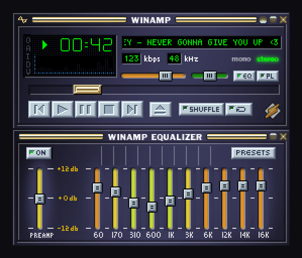
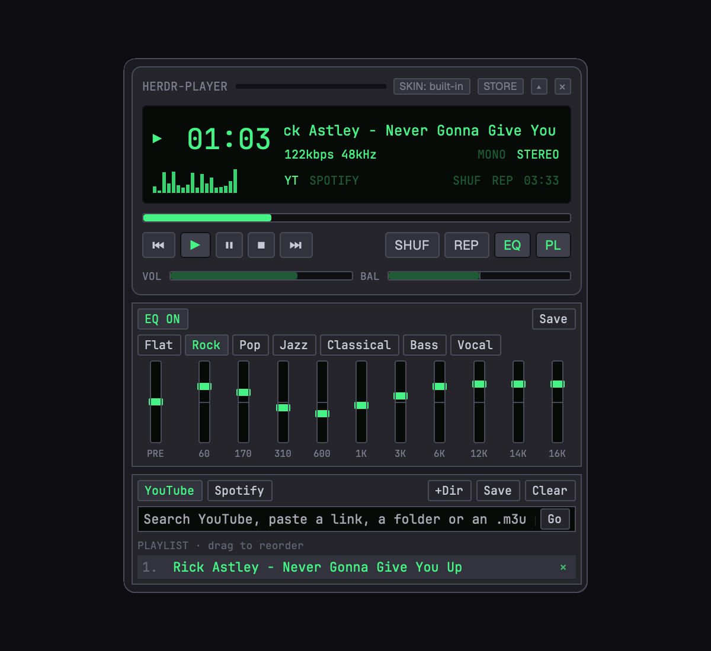
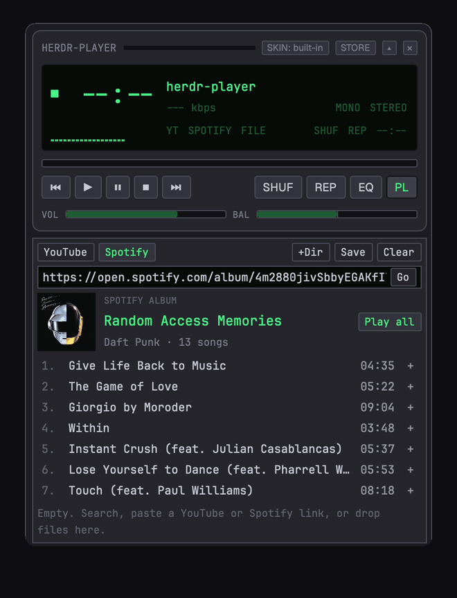

# herdr-player

A tiny retro music player that lives inside [Herdr](https://herdr.dev). YouTube, Spotify links and your own files, wearing real Winamp-era skins.



## Your old Winamp skins work here

Back in the Winamp days, people made skins for their music player and shared them as `.wsz` files. Tens of thousands of them. The [Winamp Skin Museum](https://skins.webamp.org) saved over 100,000.

herdr-player wears them. Open the built-in store, search or hit Random, click one, done. Got an old `.wsz` lying around? Drop it on the player.

Prefer something cleaner? There's a built-in look too.



## Spotify, no account needed

Open the Spotify tab and paste any song, album, playlist or artist link. You see the cover and the track list. Hit Play all, or click a song.

It doesn't need the Spotify app or a login. herdr-player reads the track list from Spotify's public page, finds each song on YouTube, and plays it right in the player.



## What it does

- **YouTube.** Search, paste a video, or paste a whole playlist.
- **Spotify.** Paste a song, album, playlist or artist into the Spotify tab. No app or account.
- **Your files.** Drop a folder, some songs or an `.m3u` on it.
- **Skins.** Any classic `.wsz` skin, one click from the store.
- **The good stuff.** A 10-band EQ with presets, balance, shuffle, repeat and a visualizer. It folds down to a single line when you only want the song title.

## Install

Ask your Herdr agent:

> Add herdr.dev/mods/dogebonker/herdr-player

It needs mpv and yt-dlp:

```sh
brew install mpv yt-dlp
```

## Keys

| Key | Does |
| --- | --- |
| `cmd-shift-m` | Open or close the player |
| `cmd-alt-p` | Play or pause |
| `cmd-alt-n` | Next track |

They work while Herdr is in front and the player is open.

## Good to know

- YouTube tracks download before they play, so give them a few seconds. They're cached for 14 days.
- Closing the player stops the music.
- macOS only for now.

Skins come from [skins.webamp.org](https://skins.webamp.org). Not affiliated with Winamp or Webamp.

MIT licensed.
