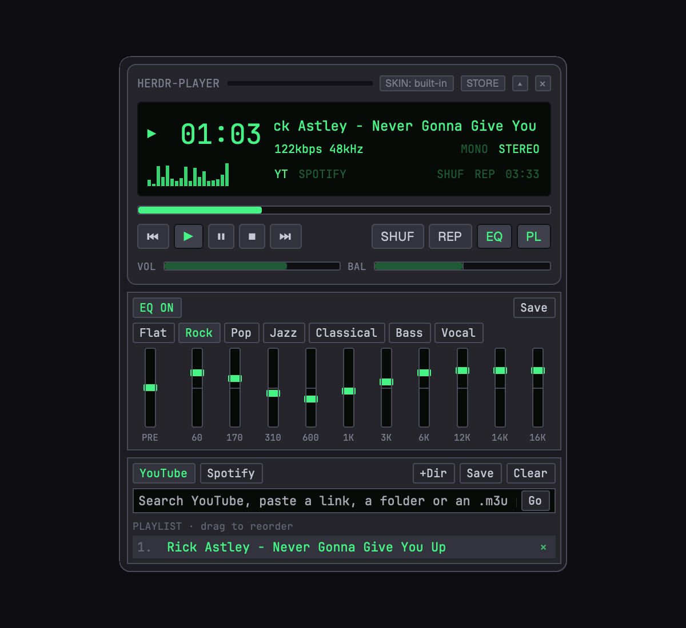

# herdr-player

A floating retro music window for Herdr. It plays YouTube, Spotify and your own files, and wears classic Winamp 2 `.wsz` skins from a built-in store. Spotify links work with no account (each song is found on YouTube); connect Spotify Premium for search, your playlists and Spotify's own audio.

## What you see

A Herdr window (`kind: "window"`, `frame: "none"`, key `herdr-player`, kept across restarts), sized by its content. Top to bottom:

- **Main window.** Built-in look: 380 px wide, case `#26262d`, bevelled keys (`#33333c`, edges `#4a4a57` / `#111115`), radius 8. A title bar (`HERDR-PLAYER`, a `SKIN: <name>` chip, `STORE`, shade `▴`, close `×`). An LCD (`#070b08`) in JetBrains Mono: state glyph, a 24 px clock, a visualizer, the title as a marquee, `kbps kHz` and `MONO STEREO`, `YT SPOTIFY FILE` (where the playing track came from, lit `#45f585`), `SHUF REP` and the track length. Then the seek bar, the keys `⏮ ▶ ⏸ ⏹ ⏭ SHUF REP EQ PL`, and VOL and BAL bars.
- **Skinned instead:** the classic 275×116 main window drawn from the skin's sprite sheets at the classic coordinates (title bar, clutter bar, digits, bitmap-font marquee, kbps/kHz, mono/stereo, volume and balance frames with thumbs, EQ/PL toggles, seek bar, transport, eject, shuffle, repeat). 1× or 2×.
- **Equalizer** (EQ toggle): built-in, an `EQ ON/OFF` chip, presets (Flat, Rock, Pop, Jazz, Classical, Bass, Vocal, and Custom once saved) and 11 vertical sliders (preamp and 60, 170, 310, 600, 1K, 3K, 6K, 12K, 14K, 16K, ±12 dB). With a skin that has `eqmain.bmp`, the skin's own equalizer.
- **Playlist** (PL toggle, open by default): `YouTube` / `Spotify` tabs, `+Dir`, `Save`, `Clear`, and a link or search box. YouTube tab: search results. Spotify tab: the loaded link's card (56 px cover, `SPOTIFY <KIND>`, its name in 13 px bold, artist or owner and song count, `Play all`) and its songs (number, title, artist unless it's an album, length, `+`), the playing one lit. Then the queue. Skinned, it takes the skin's `pledit.txt` colours.
- Built-in, the three parts sit on one backing panel (`#1b1b21`, radius 10, 6 px padding).
- **Skin store**, a second window (key `herdr-player-store`, 600×640): `SKIN MUSEUM`, a search box, `Random`, and a 2-column grid of cards: the skin's main window (275×116) and its name, with `Get & use`, `Use` or `In use`.

## How it behaves

- **Playing:** a YouTube search shows 12 results. A click plays one, `+` queues it, shift-click queues and plays. A video link plays. A playlist link plays its first track at once and queues the rest one by one. A path starting with `/` or `~/` adds local audio. A Spotify track, album, playlist or artist link (`open.spotify.com/…` or `spotify:…`) is read from Spotify's public embed page (`open.spotify.com/embed/<kind>/<id>`, the `__NEXT_DATA__` JSON: `entity.name`/`artists` for a track, `entity.trackList[].title`/`subtitle`/`duration` otherwise). Each song becomes a `ytsearch5:<artists> - <title> audio` search, and the first result within 15 s of Spotify's length (else the first) plays like a YouTube track. The first song plays at once, the rest queue behind it. In the Spotify tab a link loads first (cover cached in `.spotify/`), then `Play all`, a click (plays that song) or `+` (queues it). The last Spotify link is kept and loads again when the player opens.
- **Display:** clicking the clock switches elapsed and remaining. Clicking the visualizer cycles bars (motion only), meter (live left/right RMS from mpv) and off. The marquee scrolls titles that don't fit, natively.
- **Sliders:** seek, volume, balance and EQ follow a drag anywhere in the window and apply on release. Leaving the window releases them. Balance snaps to centre within 8%.
- **Queue:** click plays, `×` removes, press a row and release on another to move it. `Save` writes `herdr-player.m3u` into a folder you pick. `+Dir` and the skinned eject add a folder. Dropping files, folders, `.m3u` or `.wsz` on the window adds them.
- **Skins:** the `SKIN` chip (built-in), the skinned options button, or the clutter bar's O cycles built-in → each installed skin. The clutter bar's I and the options button open the store, D toggles 2×, V cycles the visualizer. Shade (either look) folds to a one-line strip.
- **Store:** opens on the museum's own order, 24 per page, `More skins` for the next page. Search uses the museum's search. Adult skins are hidden. `Get & use` downloads the skin and switches the player to it. `Random` picks a random skin from the whole museum and uses it.
- **Spotify Premium** (optional, `spotify.js`): the Spotify tab's account line says `Spotify Premium? Connect it.` with `Install` (runs `brew install spotify_player` in a visible terminal) or `Connect` (runs the full `spotify_player` there once: it opens Spotify's login page and saves the login; you quit it with `q`). Logged in is `credentials.json` and a `*_token.json` in `~/.cache/spotify-player`; the player checks every 5 s while the tab shows. Then it starts `spotify_player` hidden in herdr-core (`hc run --bg --name herdr-spotify`) and waits up to 20 s for its command port (UDP 8080). spotify_player logs in and starts streaming (Premium only) before it opens that port, and exits if that fails, so the port means ready; on a timeout it's killed. The line reads `Spotify · connecting…`, `Spotify · Premium` (with `Playlists` and `Liked`) or `Spotify didn't connect (Premium?)` (with `Retry`). Ready, the box searches Spotify (`search -- <q>`: songs, then albums, playlists and artists to open), and private playlists open through `get item`. Play all and song clicks `connect --name spotify-player` (only then: it takes over playback from other devices), `playback start context|liked|track`, wait until `get key playback` says it plays, then pause mpv. The transport, seek (by offset), volume, shuffle and repeat (one step per click; SHUF and REP light from Spotify's state) drive Spotify while it plays; `+` is hidden. Starting anything in mpv pauses Spotify, and the newest action wins. Without Premium, Spotify links still play through YouTube matching. Closing the player ends the hidden instance.
- **Keys:** `herdr-player.toggle` and `herdr-player.next` reach an open player.
- Closing the player quits mpv.

## Built from

- `mods/herdr-player/mod.json`: `place: "none"`, overlay `{ kind: "window", key: "herdr-player", keep: true, frame: "none" }` (no width: the window fits its content).
- `main.js`: the `Player` view. State, settings in `localStorage`, polling (1 s, 150 ms for the meter), actions, sliders. Opened with props `{ store: true }`, the same mod is the store (`store.js`).
- `classic.js` (built-in main window), `skin.js` (skinned main window and equalizer, the `text.bmp` font map), `panels.js` (playlist, built-in equalizer, presets).
- `mpvctl.py`: sends mpv JSON-IPC commands on `~/Library/Caches/herdr-player/mpv.sock` (a folder only you can open: mpv's socket accepts `run`) and prints the replies by `request_id`.
- `skin.py`: unzips a `.wsz` (names matched case-insensitively), converts each sheet to nearest-neighbour PNGs at 2× and 4× with ffmpeg, writes a 3×16 visualizer gradient and `manifest.json` (sheet sizes, `viscolor.txt`, `pledit.txt`).
- Programs: `mpv` (started with `hc run --bg --name herdr-player`), `yt-dlp` (search, playlists, downloads into `~/Library/Caches/herdr-player`, run through `hc run --bg`), `ffmpeg`/`ffprobe`, `curl` (store), `python3`, `find`.
- Network: `api.webamp.org/graphql` and `r2.webampskins.org` (store), YouTube (yt-dlp).
- Herdr: `exec`, `hc`, `openOverlay`, `closeOverlay`, `props`, `shared`/`setShared` (`herdr-player.skin`: the store tells the player which skin to use), `nextCommand`, `pickFolder`, `writeTextFile`, `readTextFile`, `notify`.
- `keys.json`: `cmd-shift-m` `mod.open:herdr-player`, `cmd-alt-p` `herdr-player.toggle`, `cmd-alt-n` `herdr-player.next`.

## Watch out

- YouTube refuses mpv's own stream request (HTTP 403). Download with yt-dlp first and play the file.
- `exec` stops after 30 s: run downloads and mpv through `hc run --bg` and poll for the file.
- Saving any file in the mod folder reloads the mod, and a reload closes the window's mpv. Keep downloaded skins, converted sheets and store previews in hidden folders (`.skins/`, `.store/`).
- Herdr smooths scaled images. Pre-scale sprite sheets to the exact screen pixels (2× and 4× for retina) or pixel art blurs. A sprite is a fixed-size `overflow_hidden` box with the sheet inside at a negative offset.
- In a JS string handed to `sh -c`, a comma inside an ffmpeg filter needs `\\,`.
- mpv reports silence as `-inf`, so guard the meter against NaN. After `stop` no queue entry is current: remember the index.
- A pane receives its props through `props()`, not through `init`'s argument.
- Spotify links: accept only `https://open.spotify.com/` or `spotify:` with a kind of track, album, playlist or artist and an alphanumeric id. Episodes and shows aren't songs: refuse them.
- Treat museum data as untrusted: hex md5 for file names, `https://` URLs only.
- The window must not have a fixed width, or wider content (the backing panel, 2× skins) is cut off.
- spotify_player's CLI starts its own session when no instance answers on its port, and that can wait for a browser login: never run a command before the hidden instance listens (`lsof -nP -a -iUDP:8080 -c spotify_p`; `-c` is case-sensitive). `spotify_player authenticate` doesn't save the login librespot needs: log in with the full app. `get key devices` comes back empty with the default client ID, so don't detect Premium by devices. Repeat cycles off → track → context. `playback …` exits 0 before the running instance acts: confirm with `get key playback`. It prints `\\n` inside JSON strings as real newlines: turn them back before parsing. Ids are bare strings, durations `{secs, nanos}`, `get item` replies are tagged (`{"Playlist": {playlist, tracks}}`), a playlist owner is `[name, id]`. Seek takes an offset from now. Written from spotify_player 0.25.1's source.
- macOS only: `~/Library/Caches`, and sheets pre-scaled for retina.

## Done when

- `herdr-app check mods/herdr-player` passes and `cmd-shift-m` opens the window.
- A YouTube search lists results, and a click plays one with time, kbps, kHz and stereo shown.
- Dropping a folder of mp3s queues them, and Play after Stop resumes the same track.
- EQ presets and balance change the sound, and the meter moves with the music.
- `Get & use` in the store switches the player to that skin, pixel-sharp, and `Random` picks a new one.
- A pasted Spotify album link plays its first song within seconds, the display lights `SPOTIFY`, and the rest of the album fills the queue.
